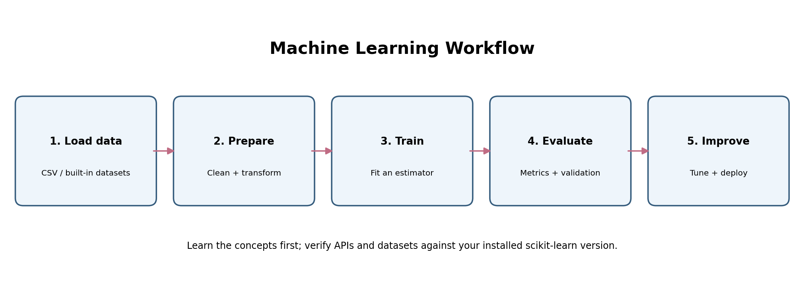
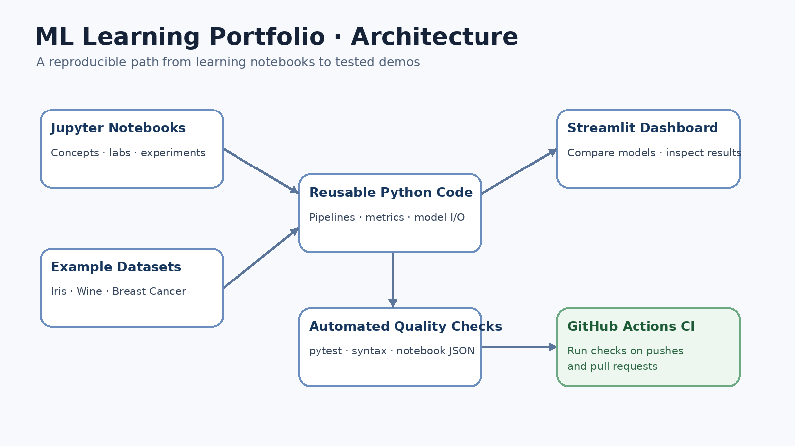
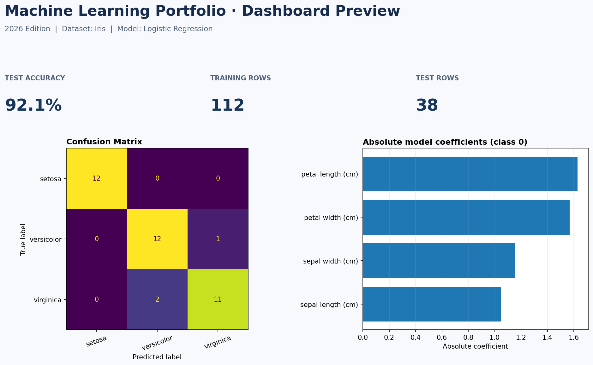
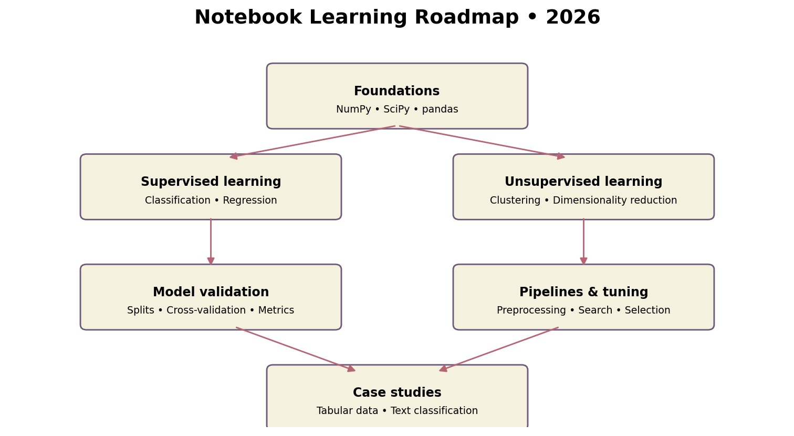
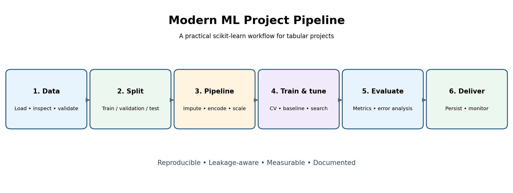
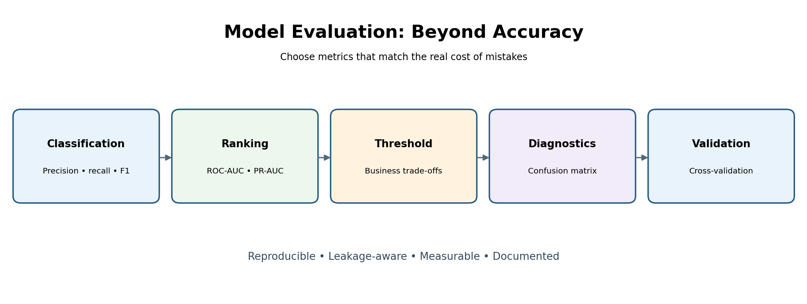
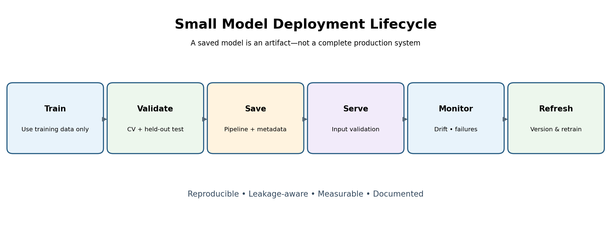

# SciPy & Scikit-learn Learning Portfolio — 2026 Edition


[](https://github.com/harpreetsingh171190-cmyk/scipy-sklearn-ml-portfolio/actions/workflows/ci.yml)
[](LICENSE)

A refreshed learning and portfolio repository based on a 2017 scientific-Python / machine-learning course. It combines the original learning material with modernized setup notes, new applied notebooks, reusable model utilities, automated tests, example training scripts, and a Streamlit dashboard.

## Portfolio highlights

- **35 Jupyter notebooks** covering fundamentals through model comparison, explanation, class imbalance and experiment tracking.
- **Reusable code** in `src/ml_portfolio.py`: 5 models x 4 datasets, cross-validated leaderboard, permutation importance, JSON experiment log, and checksum-verified model save/load.
- **Command-line tool** (`python -m src.cli`) to train, compare, predict and review runs.
- **Interactive dashboard** with fourteen tabs (Results, Leaderboard, Explain, Predict, Experiment log, Tune, Regression, Clustering, Your CSV, Text spam, Quality & risk, Ensembles & features, SHAP-style explain, Forecast & report), ROC/PR and learning curves, and CSV export.
- **Practical examples** for Iris and Breast Cancer classification.
- **Automated tests** with pytest and a GitHub Actions workflow for Python 3.11, 3.12 and 3.13 (lint, tests, notebook syntax check, CLI smoke tests).
- **Visual documentation** in `images/` and an architecture overview in `docs/ARCHITECTURE.md`.







## Quick start

### 1. Create an environment

Python 3.11 or newer (CI covers 3.11-3.13).

```bash
python -m venv .venv
# Windows PowerShell:
.venv\Scripts\Activate.ps1
# macOS/Linux:
# source .venv/bin/activate
python -m pip install --upgrade pip
python -m pip install -r requirements.txt
python -m pip install -e ".[test,app]"
```

If editable installation is not needed, install the app and test extras directly with `python -m pip install pytest streamlit`.

### 2. Launch JupyterLab

```bash
jupyter lab
```

Open `check_env.ipynb` first, then explore `notebooks/`. Start with the numbered introductory notebooks and move to the new advanced notebooks.

### 3. Launch the portfolio dashboard

```bash
streamlit run apps/portfolio_dashboard.py
```

The dashboard runs locally and uses datasets bundled with scikit-learn; no dataset download is required. The smaller Iris demo is also available at `apps/streamlit_iris_demo.py`.

### 4. Run the example scripts

```bash
python examples/train_iris.py
python examples/train_breast_cancer.py
```

The Iris script writes a local model to `artifacts/`; this generated directory is intentionally excluded from Git.

### 4b. Use the command line

```bash
python -m src.cli compare --dataset wine
python -m src.cli train --dataset breast_cancer --model hist_gradient_boosting --importance
python -m src.cli predict --features 5.1,3.5,1.4,0.2   # uses artifacts/model.joblib (iris model)
python -m src.cli runs
python -m src.cli tune --dataset breast_cancer --model svm_rbf
python -m src.cli regress
python -m src.cli cluster --dataset wine
python -m src.cli report --dataset iris
python -m src.cli csv --path my_data.csv --target label
python -m src.cli text-predict --text "Free prize, call now"
python -m src.cli anomaly --dataset wine
python -m src.cli threshold --cost-fn 10
python -m src.cli drift --reference old.csv --current new.csv
python -m src.cli profile --path my_data.csv --target label
python -m src.cli ensemble --dataset iris          # soft voting + stacking vs base models
python -m src.cli calibrate --dataset breast_cancer
python -m src.cli pca --dataset wine
python -m src.cli select --dataset wine --k 3
python -m src.cli explain --dataset iris --row 100  # SHAP-style contributions
python -m src.cli explain-regression
python -m src.cli imbalance --minority-fraction 0.1
python -m src.cli csv-explain --path my_data.csv --target label --row 0
python -m src.cli csv-imbalance --path my_data.csv --target label
python -m src.cli forecast --horizon 6
python -m src.cli html-report --dataset iris --cv 3 --out report.html
```

Run `python -m src.cli --help` for every option.

Optional: `make install`, `make test`, `make lint`, or `docker build -t ml-portfolio . && docker run -p 8501:8501 ml-portfolio`.

### 4c. Serve models with FastAPI

```bash
python -m pip install -r requirements-api.txt
uvicorn api.main:app --reload          # interactive docs: http://127.0.0.1:8000/docs
curl -X POST http://127.0.0.1:8000/predict-text -H "Content-Type: application/json" \
     -d '{"texts": ["WINNER!! Claim your free prize now"]}'
```

Endpoints: `GET /health`, `GET /info`, `POST /predict` (tabular), `POST /predict-text` (spam/ham), `POST /explain`, `GET /feature-ranking`, `GET /pca`, `GET /imbalance`, `GET /report.html`, and CSV uploads as the raw request body (`POST /csv/profile`, `/csv/explain`, `/csv/imbalance`, `/csv/forecast`, e.g. `curl -X POST -H "Content-Type: text/csv" --data-binary @data.csv "http://127.0.0.1:8000/csv/profile"`). Inputs are validated (batch limit 100, text limit 2000 characters, CSV limit 2 MB / 50,000 rows). Set `ML_API_KEY` to require an `X-API-Key` header (e.g. `ML_API_KEY=secret uvicorn api.main:app`); with no key set the API is open, so keep it on `127.0.0.1` for local use.

### 5. Run automated tests

```bash
python -m pytest -q
python scripts/check_notebooks.py      # notebook JSON + syntax check, no Jupyter needed
ruff check src tests examples apps api scripts
```

GitHub Actions runs these checks for pushes and pull requests.

## Repository map

```text
.
├── .github/                   # CI workflow, issue/PR templates, Dependabot
├── apps/                      # Streamlit demos and dashboard
├── src/                       # Library, text module, serving logic, CLI
├── api/                       # FastAPI service
├── Dockerfile, Makefile       # Container and task shortcuts
├── datasets/                  # Dataset notes and safe sourcing guidance
├── docs/ARCHITECTURE.md       # Architecture diagram source (Mermaid)
├── examples/                  # Runnable model training examples
├── images/                    # Learning and architecture diagrams
├── notebooks/                 # Original and updated Jupyter lessons
├── src/ml_portfolio.py        # Reusable model utilities
├── scripts/                   # Helper scripts (notebook checker)
├── tests/                     # Automated tests
├── check_env.ipynb            # Environment verification
├── requirements.txt           # Core dependencies
└── pyproject.toml             # Project metadata and optional dependencies
```

## Datasets and responsible use

The dashboard uses scikit-learn's bundled Iris, Breast Cancer Wisconsin, and Wine datasets. See [`datasets/README.md`](datasets/README.md) for dataset context and trusted sources for additional practice data. The breast-cancer dataset is for programming education only; this project is not a medical tool.

## Images and architecture

- [Machine learning workflow](images/ml-workflow-2026.png)
- [Model evaluation overview](images/model-evaluation-2026.png)
- [Modern ML pipeline](images/modern-ml-pipeline-2026.png)
- [Deployment lifecycle](images/deployment-lifecycle-2026.png)
- [Portfolio architecture diagram](images/portfolio-architecture-2026.png)
- [Dashboard preview](images/dashboard-preview-2026.png)
- [Architecture documentation](docs/ARCHITECTURE.md)

## GitHub upload checklist

1. Create a new GitHub repository named `scipy-sklearn-ml-portfolio` (if you pick another name, update the badge, `CITATION.cff` and `pyproject.toml` URLs).
2. Extract this ZIP and open a terminal in the extracted project folder.
3. Set your Git identity if it is not already configured, then run:

   ```bash
   git init
   git add .
   git commit -m "Prepare 2026 machine learning portfolio"
   git branch -M main
   git remote add origin https://github.com/harpreetsingh171190-cmyk/scipy-sklearn-ml-portfolio.git
   git push -u origin main
   ```

4. Check the **Actions** tab: the CI badge at the top turns green once lint, tests and smoke tests pass.
5. In repository settings add a short description and topics (suggested: `scikit-learn`, `scipy`, `machine-learning`, `jupyter-notebook`, `fastapi`, `streamlit`, `portfolio`, `python`), and enable *Private vulnerability reporting* (referenced by `SECURITY.md`).

## Compatibility notes

This is a learning portfolio, not a claim that every historical 2017 notebook has been fully migrated or executed against every current dependency. New portfolio utilities and tests are covered by CI; some older notebooks may require cell-by-cell adjustments. Consult [`MODERNIZATION_NOTES.md`](MODERNIZATION_NOTES.md) before treating legacy examples as production code.

## Security note

Only load `joblib`/pickle model files that you created or obtained from a trusted source. Such files can execute code during loading. Do not commit API keys, private datasets, credentials, or personal information.

---

## Original course notes

The original course materials and historical background are retained below for context.

---

# SciPy / scikit-learn Tutorial — Modernized for 2026

This repository refreshes the **SciPy 2017 scikit-learn tutorial** into a Python 3 / Jupyter Notebook learning workspace. The original teaching material is preserved where practical, notebook metadata and selected legacy APIs have been updated, and the setup instructions and visuals have been refreshed.

> **Important:** this is a community modernization of historical course material, not an official 2026 release by the original tutorial authors. Because the notebooks were written for the 2017 Python/scikit-learn ecosystem, not every old cell has been fully re-authored or verified against every current package version. Read [`MODERNIZATION_NOTES.md`](MODERNIZATION_NOTES.md) and run notebooks from top to bottom.


## What's included

- 35 lesson notebooks covering foundations, supervised and unsupervised learning, validation, pipelines, model selection, text features, case studies, mixed-type preprocessing, model interpretation, threshold tuning, calibration, model persistence, model comparison, and experiment tracking.
- `check_env.ipynb` — checks your Python and core scientific-package versions.
- `requirements.txt` and `environment.yml` — modern Python environment setup.
- `images/` — workflow, roadmap, evaluation, deployment, and original lesson assets.
- Twelve new 2026 notebooks (24-35): modern tabular pipelines, interpretation/error analysis, threshold tuning/calibration, model persistence, leaderboards, experiment tracking, regression/clustering, tuning, text API, data drift, ensembles, and explanations/imbalance.
- `apps/streamlit_iris_demo.py` — optional local interactive model demo (install Streamlit separately).
- `requirements-optional-apps.txt` — optional app dependency.
- `MODERNIZATION_NOTES.md` — changes, compatibility warnings, and recommended workflow.

## Learning roadmap









## Requirements

Recommended baseline for this refresh:

- Python **3.11 or newer**
- NumPy, SciPy, pandas, Matplotlib, Pillow
- scikit-learn
- JupyterLab / Jupyter Notebook and IPython kernel

The exact latest compatible versions depend on your operating system and Python version. The requirement file uses lower bounds rather than pinning one exact 2026 patch release.

## Setup

### Option A — pip + virtual environment

```bash
python -m venv .venv
```

Activate it:

- **Windows PowerShell:** `.venv\\Scripts\\Activate.ps1`
- **macOS/Linux:** `source .venv/bin/activate`

Install packages:

```bash
python -m pip install --upgrade pip
python -m pip install -r requirements.txt
```

Start JupyterLab:

```bash
jupyter lab
```

Or start classic notebook:

```bash
jupyter notebook
```

Open `check_env.ipynb` first, run all cells, then choose a lesson from `notebooks/`.

### Option B — Conda / Mamba

```bash
conda env create -f environment.yml
conda activate scipy-2017-sklearn-modern
jupyter lab
```

## Lesson notebooks

- [01.Introduction to Machine Learning](notebooks/01.Introduction_to_Machine_Learning.ipynb)
- [02.Scientific Computing Tools in Python](notebooks/02.Scientific_Computing_Tools_in_Python.ipynb)
- [03.Data Representation for Machine Learning](notebooks/03.Data_Representation_for_Machine_Learning.ipynb)
- [04.Training and Testing Data](notebooks/04.Training_and_Testing_Data.ipynb)
- [05.Supervised Learning-Classification](notebooks/05.Supervised_Learning-Classification.ipynb)
- [06.Supervised Learning-Regression](notebooks/06.Supervised_Learning-Regression.ipynb)
- [07.Unsupervised Learning-Transformations and Dimensionality Reduction](notebooks/07.Unsupervised_Learning-Transformations_and_Dimensionality_Reduction.ipynb)
- [08.Unsupervised Learning-Clustering](notebooks/08.Unsupervised_Learning-Clustering.ipynb)
- [09.Review of Scikit-learn API](notebooks/09.Review_of_Scikit-learn_API.ipynb)
- [10.Case Study-Titanic Survival](notebooks/10.Case_Study-Titanic_Survival.ipynb)
- [11.Text Feature Extraction](notebooks/11.Text_Feature_Extraction.ipynb)
- [12.Case Study-SMS Spam Detection](notebooks/12.Case_Study-SMS_Spam_Detection.ipynb)
- [13.Cross Validation](notebooks/13.Cross_Validation.ipynb)
- [14.Model Complexity and GridSearchCV](notebooks/14.Model_Complexity_and_GridSearchCV.ipynb)
- [15.Pipelining Estimators](notebooks/15.Pipelining_Estimators.ipynb)
- [16.Performance metrics and Model Evaluation](notebooks/16.Performance_metrics_and_Model_Evaluation.ipynb)
- [17.In Depth-Linear Models](notebooks/17.In_Depth-Linear_Models.ipynb)
- [18.In Depth-Trees and Forests](notebooks/18.In_Depth-Trees_and_Forests.ipynb)
- [19.Feature Selection](notebooks/19.Feature_Selection.ipynb)
- [20.Unsupervised learning-Hierarchical and density-based clustering algorithms](notebooks/20.Unsupervised_learning-Hierarchical_and_density-based_clustering_algorithms.ipynb)
- [21.Unsupervised learning-Non-linear dimensionality reduction](notebooks/21.Unsupervised_learning-Non-linear_dimensionality_reduction.ipynb)
- [22.Unsupervised learning-anomaly detection](notebooks/22.Unsupervised_learning-anomaly_detection.ipynb)
- [23.Out-of-core Learning Large Scale Text Classification](notebooks/23.Out-of-core_Learning_Large_Scale_Text_Classification.ipynb)


## New 2026 modules

- [24. Modern Tabular Pipelines](notebooks/24.Modern_Tabular_Pipelines.ipynb) — imputation, scaling, one-hot encoding, `ColumnTransformer`, cross-validation.
- [25. Model Interpretation & Error Analysis](notebooks/25.Model_Interpretation_and_Error_Analysis.ipynb) — permutation importance, confusion matrix, precision-recall curve.
- [26. Threshold Tuning & Calibration](notebooks/26.Threshold_Tuning_and_Calibration.ipynb) — validation-based threshold selection, precision/recall trade-offs, calibration.
- [27. Save, Load & Reuse a Model](notebooks/27.Save_Load_and_Reuse_a_Model.ipynb) — model persistence with `joblib` and metadata.
- [28. Model Comparison Leaderboard](notebooks/28.Model_Comparison_Leaderboard.ipynb) — fair cross-validated comparison of model families.
- [29. Experiment Tracking with JSON Lines](notebooks/29.Experiment_Tracking_with_JSON_Lines.ipynb) — logging runs and permutation importance.
- [30. Regression and Clustering](notebooks/30.Regression_and_Clustering.ipynb) — regression metrics and KMeans silhouette.
- [31. Hyperparameter Tuning](notebooks/31.Hyperparameter_Tuning.ipynb) — grid vs random search.
- [32. Text Classification and a Prediction API](notebooks/32.Text_Classification_and_API.ipynb) — TF-IDF spam detection and serving.
- [33. Data Quality, Drift and Anomalies](notebooks/33.Data_Quality_Drift_and_Anomalies.ipynb) — profiling, drift, anomalies, cost-based thresholds.
- [34. Ensembles, Calibration and Feature Selection](notebooks/34.Ensembles_Calibration_and_Feature_Selection.ipynb) — voting/stacking, Brier score and ECE, PCA, ANOVA/mutual-information ranking.
- [35. Explaining Predictions and Imbalance](notebooks/35.Explaining_Predictions_and_Imbalance.ipynb) — SHAP-style contributions and class-imbalance strategies.

### Optional interactive demo

After installing the base requirements, install the optional app dependency and run:

```bash
python -m pip install -r requirements-optional-apps.txt
streamlit run apps/streamlit_iris_demo.py
```

The app is an educational local demo; it is not a production service.

## Datasets

Some lessons use local files under `notebooks/datasets/`; other examples may download datasets or require network access. Run only from a trusted environment and review download code before executing it. Dataset availability and download endpoints can change over time.

## Recommended workflow

1. Create the environment above.
2. Run `check_env.ipynb`.
3. Open one lesson notebook at a time.
4. Use **Restart Kernel and Run All Cells** to find compatibility issues from the beginning.
5. If an older API or dataset fails, consult `MODERNIZATION_NOTES.md`, then update that lesson in a separate commit.

## Images

- `images/ml-workflow-2026.png` — machine-learning workflow overview.
- `images/notebook-roadmap-2026.png` — lesson topic map.
- `images/modern-ml-pipeline-2026.png` — practical model-development pipeline.
- `images/model-evaluation-2026.png` — evaluation metrics and threshold concepts.
- `images/deployment-lifecycle-2026.png` — save, serve, monitor, and refresh lifecycle.

## Credits and license

The original tutorial material was associated with the SciPy 2017 tutorial and its original contributors. See [`LICENSE`](LICENSE) for the repository's license. This refresh does not claim authorship of the original course material.

## Disclaimer

Educational material only. The notebooks are not a substitute for checking the current official documentation for Python, NumPy, SciPy, pandas, Matplotlib, Jupyter, and scikit-learn.


## New in v3.4

```bash
python -m src.cli ensemble --dataset iris        # base models vs voting / stacking
python -m src.cli calibrate --model random_forest # Brier score and ECE before/after calibration
python -m src.cli pca --dataset wine --variance 0.95
python -m src.cli select --dataset wine --k 5 --method mutual_info
```

```bash
python -m src.cli explain --dataset iris --row 100          # SHAP-style contributions
curl -X POST localhost:8000/explain -H "Content-Type: application/json" \
     -d '{"dataset":"iris","row":[6.5,3.0,5.5,2.0],"top_k":3}'
```

## New in v3.5

```bash
python -m src.cli imbalance --minority-fraction 0.05 --model random_forest
python -m src.cli explain-regression --model random_forest --row 3
```

## New in v3.6 — your own CSV

```bash
python -m src.cli csv-explain --path data.csv --target churn --row 0
python -m src.cli csv-imbalance --path data.csv --target churn
```

## New in v3.7

```bash
python -m src.cli forecast --path sales.csv --value sales --date day --horizon 12
python -m src.cli html-report --dataset wine --out artifacts/report.html
# API: upload a CSV as the raw body
curl -X POST "localhost:8000/csv/forecast?value=sales&date=day&horizon=6" \
     -H "Content-Type: text/csv" --data-binary @sales.csv
curl "localhost:8000/report.html?dataset=iris" -o report.html
```
