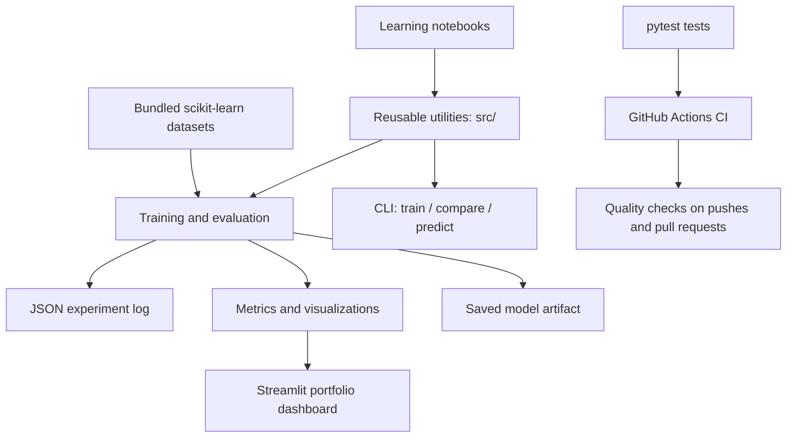

# Project architecture

## Design principles

- Keep data preparation and estimators inside scikit-learn pipelines to reduce leakage.
- Fix random seeds for reproducible demonstrations.
- Test model behavior and notebook file integrity automatically.
- Use built-in example datasets by default to avoid network dependencies.
- Verify model files with a SHA-256 sidecar before loading.
- Treat model artifacts as trusted executable data: only load files from sources you trust.
